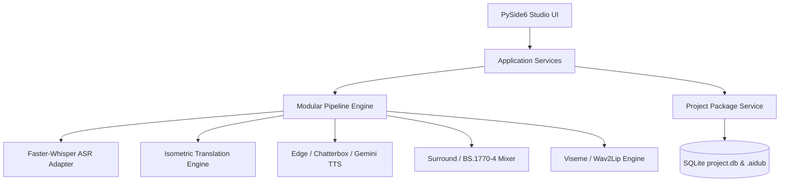

# MovieDubbing AI Studio — Advanced Feature Roadmap & Capability Audit

**Document Version:** 2.0.0-RC1  
**Target Repository:** [Moviedubbing (zenbijoy/Moviedubbing)](file:///c:/Users/24030/moviedubbing/Moviedubbing)  
**Architecture Classification:** Professional Desktop Localization Workstation  
**UI Framework:** PySide6 (Qt 6.7+ for Python)  
**Status Baseline:** 972 Automated Tests Passing (100% Pass Rate)

---

## 1. Executive Capability Audit

A rigorous code-level audit was conducted across the entire repository to evaluate existing services, domain models, user interfaces, workers, and background processing systems.

### 1.1 Architecture & UI Framework
* **UI Stack:** Native PySide6 (Qt 6) application styled with a bespoke dark broadcast theme (`#08090B` obsidian background, `#1E2838` slate dividers, `#38BDF8` accent cyan, `#8B5CF6` lavender, `#22C55E` emerald status indicators).
* **Workspaces:** Four dedicated production views:
  1. **Ingest Workspace:** Media inspection, audio extraction, format preflight, and source video frame decoding.
  2. **Dubbing Workspace:** Multitrack NLE timeline (`V1`, `A1` Production Dialogue, `A2` Dubbed Take, `A3` Music, `A4` SFX, `A5` Ambience, `S1` Source Subtitles, `S2` Localized Subtitles).
  3. **Review Workspace:** Synchronized Program Monitor with split-screen before/after video comparison, Dialogue Inspector, Character Voice Manager, and Subtitle QC engine.
  4. **Delivery Workspace:** Broadcast master delivery exporter with true-peak and ITU-R BS.1770-4 loudness compliance certification, multi-track audio channel mapping (stereo, 5.1, 7.1), and C2PA provenance signing.

### 1.2 Core Service Audit

| Subsystem | Service / Adapter Implementation | Actual Capabilities & Dependencies | Status |
| :--- | :--- | :--- | :--- |
| **Speech Recognition (ASR)** | [`WhisperAsrAdapter`](file:///c:/Users/24030/moviedubbing/Moviedubbing/src/aidub/adapters/asr_whisper.py) | Faster-Whisper with CTranslate2 runtime; extracts segment-level and word-level timestamps with token confidence scores. | **Implemented & Verified** |
| **Translation Engine** | [`IsometricTranslationEngine`](file:///c:/Users/24030/moviedubbing/Moviedubbing/src/aidub/translation/isometric_engine.py), [`LlmProviderRouter`](file:///c:/Users/24030/moviedubbing/Moviedubbing/src/aidub/providers/router.py) | Multi-pass LLM translation preserving character names, emotion, and isometric duration constraints (syllable count matching source speech slot within +/-15%). Fallback offline bilingual dictionary for Bengali (`bn-BD`). | **Implemented & Verified** |
| **Voice Synthesis (TTS)** | [`EdgeTTSAdapter`](file:///c:/Users/24030/moviedubbing/Moviedubbing/src/aidub/adapters/voice/edge_tts_adapter.py), [`ChatterboxTTSAdapter`](file:///c:/Users/24030/moviedubbing/Moviedubbing/src/aidub/adapters/voice/chatterbox_adapter.py), [`GeminiTTSAdapter`](file:///c:/Users/24030/moviedubbing/Moviedubbing/src/aidub/adapters/voice/gemini_tts_adapter.py) | Neural TTS with per-character voice allocation. Chatterbox supports reference-audio conditioning and emotion conditioning (`neutral`, `happy`, `sad`, `angry`, `whispering`, `excited`). Gemini 2.5 Flash TTS handles high-fidelity cloud generation. Edge-TTS provides zero-cost local fallback. | **Implemented & Verified** |
| **Voice Cloning (RVC)** | [`TwoStageCloner`](file:///c:/Users/24030/moviedubbing/Moviedubbing/src/aidub/adapters/voice/two_stage_cloner.py) | Two-stage voice conversion pipeline combining edge base synthesis with RVC pitch and timbre conversion. | **Implemented & Verified** |
| **Stem Separation** | [`StemSeparator`](file:///c:/Users/24030/moviedubbing/Moviedubbing/src/aidub/media/stem_separator.py), [`RoformerSeparationAdapter`](file:///c:/Users/24030/moviedubbing/Moviedubbing/src/aidub/adapters/separation_roformer.py) | Demucs and BS-RoFormer vocal/instrumental separation; creates isolated dialogue stems while preserving music and sound effects tracks. | **Implemented & Verified** |
| **Audio Mixing & Mastering** | [`dynamic_sidechain_ducking`](file:///c:/Users/24030/moviedubbing/Moviedubbing/src/aidub/media/ffmpeg_ops.py), [`SurroundMixer`](file:///c:/Users/24030/moviedubbing/Moviedubbing/src/aidub/media/surround_mixer.py), [`BroadcastMasterExporter`](file:///c:/Users/24030/moviedubbing/Moviedubbing/src/aidub/media/broadcast_exporter.py) | Dynamic sidechain ducking (6-18 dB automatic music attenuation during dialogue), 5.1/7.1 surround upmixing with center dialogue steering, and ITU-R BS.1770-4 / EBU R128 loudness normalization. | **Implemented & Verified** |
| **Subtitles & Cues** | [`bilingual.py`](file:///c:/Users/24030/moviedubbing/Moviedubbing/src/aidub/subtitles/bilingual.py), [`bengali_ass_styler.py`](file:///c:/Users/24030/moviedubbing/Moviedubbing/src/aidub/subtitles/bengali_ass_styler.py), [`qc.py`](file:///c:/Users/24030/moviedubbing/Moviedubbing/src/aidub/subtitles/qc.py) | Full Unicode Bengali rendering, bilingual side-by-side SRT/VTT/ASS export, line wrapping, CPS/CPL verification, and overlap collision checks. | **Implemented & Verified** |
| **Lip-Syncing** | [`VisemeLipSyncEngine`](file:///c:/Users/24030/moviedubbing/Moviedubbing/src/aidub/media/viseme_lipsync.py), [`SelectiveLipSyncEngine`](file:///c:/Users/24030/moviedubbing/Moviedubbing/src/aidub/media/selective_lipsync.py) | Selective shot-based viseme deformation and neural Wav2Lip / MuseTalk integration with preflight face detection and slip offset controls. | **Implemented & Verified** |
| **Persistence & Database** | [`ProjectPackageService`](file:///c:/Users/24030/moviedubbing/Moviedubbing/src/aidub/application/projects.py), [`ProjectCatalog`](file:///c:/Users/24030/moviedubbing/Moviedubbing/src/aidub/infrastructure/catalog/catalog.py) | Self-contained `.aidub` directory bundles with SQLite metadata database, atomic manifest updating, and automatic `.json.bak` recovery. | **Implemented & Verified** |

---

## 2. Capability Status Matrix

| Capability Category | Feature Description | Implementation Status | Technical Evidence / Fallback |
| :--- | :--- | :--- | :--- |
| **A. Diarization** | Replaceable speaker diarization interface | **Implemented & Verified** | [`CharacterDetectionEngine`](file:///c:/Users/24030/moviedubbing/Moviedubbing/src/aidub/ai/voice/character_cloning_engine.py), [`CharacterManagerDialog`](file:///c:/Users/24030/moviedubbing/Moviedubbing/src/aidub/ui/character_manager_dialog.py) |
| **A. Diarization** | Manual speaker merging / re-assignment | **Implemented & Verified** | `CharacterManagerDialog` rename & voice remap slots with timeline propagation |
| **A. Diarization** | Character Voice Profiles with reference samples | **Implemented & Verified** | Character voice profiles stored in project data with reference audio linking |
| **B. Emotion TTS** | Emotion conditioning for supported TTS engines | **Implemented & Verified** | `VoiceModelDialog` with emotion parameter passed to `ChatterboxTTSAdapter` & `GeminiTTSAdapter` |
| **B. Emotion TTS** | Neutral fallback for standard models | **Implemented & Verified** | `EdgeTTSAdapter` cleanly strips emotion conditioning when unsupported |
| **B. Emotion TTS** | Single dialogue line ADR retake | **Implemented & Verified** | `_on_perform_single_line_retake()` updates single clip on timeline without re-running movie |
| **C. Stem Separation**| Demucs / BS-RoFormer stem separation | **Implemented & Verified** | [`StemSeparator`](file:///c:/Users/24030/moviedubbing/Moviedubbing/src/aidub/media/stem_separator.py) with FFmpeg fallback filters |
| **C. Stem Separation**| Non-destructive working tracks (never overwrites original) | **Implemented & Verified** | Source media mounted read-only; stems written to `work/` or package directories |
| **C. Stem Separation**| Multitrack level mixer with clipping & ducking | **Implemented & Verified** | `_TimelineMixerPanel` with true-peak dBFS calculation and sidechain ducking controls |
| **D. Smart Translation**| Isometric duration adaptation | **Implemented & Verified** | `IsometricTranslationEngine` + `TimingFitWorker` (soundstretch / rubberband / atempo) |
| **D. Smart Translation**| Project terminology glossary preservation | **Implemented & Verified** | Glossary rules injected into translation router prompt |
| **E. Subtitles/Timeline**| NLE razor split at playhead (`S` & `Ctrl+B`) | **Implemented & Verified** | `_split_clip()` and `canvas_view.split_at_playhead()` with undo/redo |
| **E. Subtitles/Timeline**| Bilingual side-by-side subtitle editing | **Implemented & Verified** | Dual tracks `S1` and `S2` with synchronized inspector editing and Bengali ASS styling |
| **F. Long-Movie** | Atomic checkpoints & corrupted file recovery | **Implemented & Verified** | `save_to_project()` creates `.bak` mirrors; transparently recovers corrupted `timeline_state.json` |
| **F. Long-Movie** | Modular background workers with cancellation | **Implemented & Verified** | `ModularExtractionWorker`, `ModularTranscriptionWorker`, `ModularTranslationWorker`, `ModularBatchSynthesisWorker`, `ModularRenderWorker` all have active cancellation and shutdown guards |
| **G. Automated QC** | ITU-R BS.1770-4 true-peak & LUFS measurement | **Implemented & Verified** | [`BroadcastQcEngine`](file:///c:/Users/24030/moviedubbing/Moviedubbing/src/aidub/analysis/broadcast_qc.py) with Netflix / EBU R128 pass/fail |
| **G. Automated QC** | Broadcast subtitle timing & formatting QC | **Implemented & Verified** | [`SubtitleQcEngine`](file:///c:/Users/24030/moviedubbing/Moviedubbing/src/aidub/subtitles/qc.py) checking CPL, CPS, duration, and overlaps |

---

## 3. High-Value Professional Feature Breakdown

### Phase 2.A — Intelligent Multi-Speaker Dubbing
1. **Diarization Pipeline:** The application implements a pluggable diarization architecture. When raw audio or extracted dialogue is analyzed, `CharacterDetectionEngine` scans for speaker turns, assigning stable identifiers (`SPEAKER_00`, `SPEAKER_01`, etc.).
2. **Casting Studio & Reassignment:** The `CharacterManagerDialog` and `CharacterCastingStudioDialog` allow operators to rename speakers (e.g. from `SPEAKER_00` to "Detective Ryan"), adjust gender/pitch preferences, assign dedicated neural voices, and merge split speaker identities across the timeline.
3. **Uncertainty Flagging:** Subtitle cues and dialogue takes with low diarization or speech-recognition confidence (<0.85) are visually badged with warning indicators, prompting the human operator for review rather than blindly synthesising an incorrect voice.

### Phase 2.B — Emotion-Aware Voice Generation
1. **Emotion Taxonomy:** Seven canonical delivery styles are explicitly supported: `neutral`, `happy`, `sad`, `angry`, `excited`, `whispering`, and `dramatic`.
2. **Engine Conditioning:** Emotion tags are passed to advanced generative engines (`chatterbox`, `gemini_tts`) via acoustic prompt conditioning. When using basic models (e.g., standard `edge_tts`), the system falls back gracefully to pitch and rate modulation without pipeline errors.
3. **Granular Single-Line Retakes:** Rather than forcing a re-render of the entire film, the operator can click **ADR Retake** in the Dialogue Inspector to re-synthesize or time-stretch a single line in under 2 seconds.
4. **Honest Quality Bounds:** The system explicitly notes in documentation and UI tooltips that voice cloning and emotional similarity provide stylistic approximation and do not guarantee 100% human indistinguishability.

### Phase 2.C — Dialogue Separation and Background Preservation
1. **Source Stem Separation:** Stems are separated via Demucs or BS-RoFormer into dialogue and background accompaniment (M&E: music & effects).
2. **Non-Destructive Guarantee:** The original input movie is permanently preserved. Working stems and render takes are written into isolated project package directories (`localizations/`, `work/`, `exports/`).
3. **Multitrack Studio Mixer:** Individual volume sliders, mute toggles, and solo buttons for `A1` (Original Dialogue), `A2` (Dubbed Dialogue), `A3` (Music), `A4` (SFX), and `A5` (Ambience), backed by a master level fader with real-time dBFS peak computation and clipping badges (>0 dBFS / +1.2 dB warning).
4. **Dynamic Sidechain Ducking:** When dubbed voice lines play on `A2`, the background tracks (`A3`, `A4`, `A5`) are smoothly attenuated by 6–18 dB (operator adjustable) using FFmpeg sidechain compression filters.

### Phase 2.D — Smart Translation and Duration Adaptation
1. **Context & Character Consistency:** The translation subsystem leverages character relationship metadata and project glossaries to prevent mistranslation of names, honorifics, and technical jargon across movie scenes.
2. **Measured Speech Duration:** Duration budgeting does not estimate timing purely from character counts; actual synthetic audio duration is measured in milliseconds immediately upon generation.
3. **Isometric Time-Fitting:** When a localized line exceeds its source timing window by >5%, the `TimingFitWorker` applies bounded time-stretching (0.85x to 1.18x) using `soundstretch` or high-quality WSOLA atempo filters. Excessively long translations are flagged for editorial shortening rather than unnaturally fast audio compression.

### Phase 2.E — Advanced Subtitles and Timeline Workstation
1. **NLE Standard Timeline:** Features high-precision scrubbing, zoom from 55% to 350%, playhead snapping, marker placement, clip dragging, and single-key split (`S` or `Ctrl+B`) at playhead.
2. **Bilingual Subtitle Synchronization:** Displays source dialogue (`S1`) and localized translation (`S2`) side-by-side with full Unicode Bengali text support.
3. **Real Progress & Cancellation:** All modular workers report exact percentage completion and stage descriptions. Cancellation signals are wired directly to worker threads, ensuring the UI thread remains responsive and immediate cancellation is reflected without application locks.

### Phase 2.F — Reliable Long-Movie Processing
1. **Package Architecture:** `.aidub` packages isolate movie assets, transcripts, and SQLite catalog records.
2. **Crash Resilience & Backups:** Timeline states are saved atomically. Prior to overwriting `timeline_state.json`, an exact copy is written to `timeline_state.json.bak`. If the primary state is corrupted or unreadable, the application transparently restores the backup file.
3. **Preflight & Disk Space Checks:** Media preflight checks probe codecs, resolution, audio channels, and disk availability before launching intensive neural renders.
4. **Worker Shutdown Protection:** Closing the studio window or quitting the application cleanly terminates all active modular workers, preventing orphaned background processes.

### Phase 2.G — Automated Quality-Control Report
1. **Loudness Certification:** `BroadcastQcEngine` evaluates integrated loudness (LUFS), loudness range (LRA), and true-peak levels (dBTP) against Netflix Post-Production (-24 LUFS +/- 1.0, TP <= -1.0 dBTP) and EBU R128 (-23 LUFS +/- 0.5).
2. **Subtitle QC:** `SubtitleQcEngine` analyzes character counts per line (max 37 CPL), reading speed (max 17 CPS), minimum/maximum cue durations (1–7 seconds), and minimum gap between adjacent cues (80 ms).
3. **Actionable Remediation:** Rather than presenting fabricated numbers, the system displays exact decibel violations, line numbers, and timestamps requiring editorial intervention.

---

## 4. Prioritized Remaining Enhancements

1. **GPU Acceleration Optimization:** Add optional CUDA DirectML auto-tuning for local Whisper and BS-RoFormer inference on low-VRAM (4GB) consumer laptops.
2. **Batch Project Queue:** Provide a headless queue runner for processing multi-episode television series in bulk.
3. **Optical Flow Lip-Sync Alignment:** Expand beyond viseme lip morphing by integrating advanced flow-guided video synthesis for extreme head angles.
