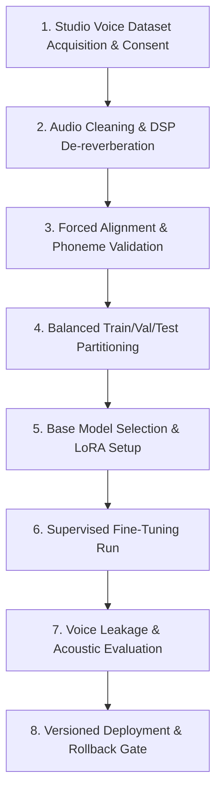

# Custom Speech Model Training & Fine-Tuning Research Roadmap

## 1. Executive Summary & Legal Pre-Flight

Before undertaking custom model training, MovieDubbing establishes a strict feasibility, copyright, and ethical pre-flight:
1. **Never Train on Scraped Movie Audio Without Rights**: Extracting audio from commercial feature films without explicit rights-holder licensing constitutes copyright infringement and breaches synthetic media agreements.
2. **Foundational Pre-training vs. Downstream Fine-Tuning**: Building a foundation speech model from scratch requires $> 50,000$ hours of diverse audio and millions in GPU compute. The pragmatic, legally sound approach for an indie/production studio is **Low-Rank Adaptation (LoRA) or downstream fine-tuning of an open, permissively licensed base model** (e.g. F5-TTS or CosyVoice under MIT/Apache 2.0).

---

## 2. Research & Engineering Roadmap

### Stage 1: Dataset Acquisition, Speaker Consent & Data Governance
- **Consent Protocol**: Every contributing voice actor signs an explicit synthetic voice addendum authorizing model training, defining permitted project domains, and detailing royalty/usage terms.
- **Corpus Target**:
  - For single-character timbre fine-tuning (LoRA): 30 to 60 minutes of high-fidelity isolated speech ($48\text{ kHz}$ 24-bit, SNR $> 28\text{ dB}$).
  - For multilingual foundation adaptation: 200+ hours of phonetically balanced speech covering regional accents (e.g. Dhaka vs. Kolkata Bengali).

### Stage 2: Audio Cleaning, Segmentation & DSP Pre-processing
- **De-reverberation & De-noising**: Apply high-order spectral gating to eliminate room acoustic reflections.
- **VAD Segmentation**: Segment speech into optimal training utterances of $3.0\text{s} \dots 12.0\text{s}$ using energy thresholding with a $200\text{ms}$ silence pad.
- **Normalization**: Standardize all training clips to $-1.0\text{ dBFS}$ true peak with ITU-R BS.1770-4 gated loudness at $-23\text{ LUFS}$.

### Stage 3: Transcript Validation & Forced Alignment
- Clean verbatim transcription with punctuation aligned with vocal pauses.
- Run forced phonetic alignment (e.g., Montreal Forced Aligner or CTC phoneme alignment) to ensure word-level timestamp accuracy within $\pm 20\text{ms}$.
- Exclude audio-text segments with alignment confidence $< 0.95$.

### Stage 4: Train / Validation / Test Separation
- **Partitioning**: $80\%$ Train, $10\%$ Validation, $10\%$ Held-Out Test.
- **Speaker & Utterance Isolation**: Ensure that testing phrases test out-of-domain vocabulary (unseen words, emotional extremes) to prevent false positive memorization.

### Stage 5: Fine-Tuning Hardware & Hyperparameter Prerequisites
- **Recommended Base Architecture**: **F5-TTS (Flow Matching DiT)**.
- **Hardware Prerequisites**:
  - Minimum: $1\times$ NVIDIA RTX 4090 ($24\text{ GB}$ VRAM) or $1\times$ A10G ($24\text{ GB}$).
  - Target: $2\times$ NVIDIA A100 ($80\text{ GB}$) for distributed DDP training.
- **Hyperparameter Guidelines**:
  - Optimizer: AdamW ($\beta_1=0.9, \beta_2=0.999$, weight decay $= 0.01$).
  - Learning Rate: $1\times 10^{-5}$ with linear warmup for the first 1,000 steps and cosine decay.
  - Precision: Mixed precision (BF16).
  - Batch Size: 32 to 64 seconds per GPU.

### Stage 6: Overfitting & Voice Leakage Safeguards
- **Voice Leakage Audit**: When training multi-speaker models, monitor cross-speaker embedding distance. If Speaker A's fine-tuned model begins producing acoustic formants belonging to Speaker B, halt training and increase identity regularization weight.
- **Acoustic Drift Check**: Evaluate validation loss every 500 steps. If mel-spectral loss increases while training loss drops, early-stop to prevent robotic over-fitting.

### Stage 7: Model Artifact Versioning & Rollback
- Every fine-tuned checkpoint is tagged with a deterministic hash: `v{major}.{minor}.{build}-{dataset_hash}`.
- Checkpoints are saved in ONNX or Safetensors format alongside:
  - Exact training hyperparameters.
  - Training dataset git commit.
  - Licensing manifest and voice owner consent certificate.
- In case of quality degradation or revoked actor consent, the application's [`CharacterProfileService`](file:///c:/Users/24030/moviedubbing/Moviedubbing/src/aidub/application/voice/character_profile_service.py) automatically rolls back to the prior certified checkpoint version.
