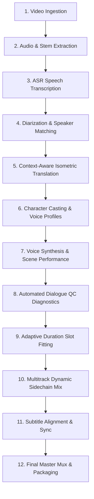

# End-to-End Testing & Cinematic Dubbing Verification Guide

This document outlines the testing architecture, reproducibility protocol, and verification standards for the **MovieDubbing Phase 2 Intelligent Voice Performance & Cinematic Studio Workflow**.

---

## 1. 12-Stage Pipeline Overview

The complete end-to-end cinematic localization test verifies the following 12 stages in sequence:



1. **Video Ingestion**: Validates video container headers, metadata, and framerate.
2. **Audio Extraction**: Extracts broadcast-quality 24kHz/48kHz linear PCM WAV and isolates speech stems.
3. **Speech Recognition (ASR)**: Generates timestamped word-level and sentence-level dialogue segments.
4. **Speaker Diarization**: Clusters speakers and assigns consistent identifiers (`SPEAKER_00`, `SPEAKER_01`).
5. **Context-Aware Translation**: Translates source dialogue with isometric syllable budgeting and character persona consistency.
6. **Character Casting**: Maps diarized speakers to persistent character profiles with versioning and cloning consent.
7. **Voice Synthesis**: Generates emotional candidate takes conditioned on scene atmosphere, dramatic tone, and character acoustic space.
8. **Automated Dialogue QC**: Validates audio against 10 defect checks (clipping, unexpected dead silence, sample rate, timing slot overruns, boundary clicks, etc.).
9. **Adaptive Duration Fitting**: Executes the 4-step hierarchy (shorter text recommendation $\to$ engine speech rate control $\to$ bounded $\pm 8\%$ time-stretch $\to$ manual review flagging).
10. **Multitrack Dynamic Sidechain Mix**: Ducks background music and environmental stems by 9dB to 12dB under active dialogue.
11. **Subtitle Alignment**: Generates synchronized SRT / ASS subtitle tracks matching localized phrasing and pauses.
12. **Master Mux & Packaging**: Encodes final dubbed ProRes / MP4 master with synchronized multitrack audio and verification manifest.

---

## 2. Running the Automated Test Suite

All tests can be executed locally on Windows, macOS, or Linux using standard pytest.

### Complete Phase 2 Test Suite
```powershell
.venv\Scripts\python.exe -m pytest tests/unit/application/test_character_profile_service.py `
                                  tests/unit/application/test_scene_performance_service.py `
                                  tests/unit/analysis/test_dialogue_qc_service.py `
                                  tests/unit/application/test_adaptive_duration_fitting.py `
                                  tests/unit/application/test_batch_dialogue_orchestrator.py `
                                  tests/unit/ui/test_audio_review_panel.py `
                                  tests/unit/application/test_benchmark_runner.py `
                                  tests/integration/pipeline/test_end_to_end_dubbing_pipeline.py -v
```

### 12-Stage End-to-End Vertical Slice
```powershell
.venv\Scripts\python.exe -m pytest tests/integration/pipeline/test_end_to_end_dubbing_pipeline.py -v
```

### Voice Engine Benchmarking Lab
```powershell
.venv\Scripts\python.exe -m pytest tests/unit/application/test_benchmark_runner.py -v
```

---

## 3. Automated Quality Control Verification Matrix

| QC Defect Check | Severity | Trigger Threshold | Remediation / Suggested Action |
|---|---|---|---|
| **Missing / Zero-Byte Audio** | `HARD_ERROR` | File missing or size == 0 bytes | Automatic re-synthesis trigger |
| **Unexpected Dead Silence** | `HARD_ERROR` | Silence ratio > 95% or RMS < -60 dBFS | Regenerate with higher gain or switch engine |
| **Digital Clipping** | `HARD_ERROR` | True peak $\ge 99.8\%$ FS | Apply soft limiter & normalize to -1.0 dBFS |
| **Sample Rate Mismatch** | `HARD_ERROR` | Sample rate $\ne$ project master rate (e.g. 24kHz/48kHz) | Resample audio via polyphase DSP filter |
| **Timing Slot Overrun** | `HARD_ERROR` | Duration delta $> 15\%$ | Trigger Adaptive Duration Fitting or shorten text |
| **Timing Slot Overlap** | `HARD_ERROR` | Cue start time $<$ previous cue end time | Shift cue boundary or trim inter-sentence pause |
| **Boundary Discontinuity / Click** | `WARNING` | Boundary DC offset $> 0.05$ | Apply 5ms cosine fade-in / fade-out |
| **Missing Speaker Profile** | `WARNING` | Cue has no character profile assigned | Assign default narrator profile |
| **Stale Audio Take** | `WARNING` | Audio generated from superseded translation version | Invalidate take and trigger batch re-render |
| **Low SNR / Background Noise** | `WARNING` | Measured SNR $< 18.0$ dB | Apply spectral subtraction / denoising filter |
