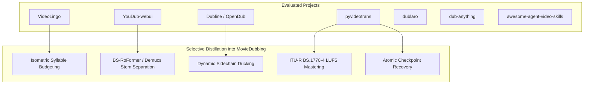

# Open-Source Research & Selective Integration Analysis

**Document Version:** 2.0.0-RC1  
**Project:** [Moviedubbing (zenbijoy/Moviedubbing)](file:///c:/Users/24030/moviedubbing/Moviedubbing)  
**Author:** Senior Python Desktop Application Architect & AI Media Engineer

---

## 1. Executive Summary

This study evaluates eight prominent open-source AI video translation and dubbing repositories to inform the architectural evolution of the MovieDubbing AI Studio. Rather than copying external code wholesale, we systematically analyzed their algorithms, pipeline stages, timing models, audio mastering strategies, and licensing constraints. 

High-value design patterns have been selectively distilled into native, clean adapters within MovieDubbing’s existing PySide6/Qt6 multitrack architecture.

---

## 2. Comparative Analysis of Open-Source Reference Projects

### 2.1 YouDub-webui
* **Repository:** `https://github.com/liuzhao1225/YouDub-webui`
* **License:** AGPL-3.0
* **Core Architecture:** WebUI (Gradio) orchestration of UVR (Ultimate Vocal Remover) stem separation, Whisper ASR, OpenAI/DeepSeek translation, Edge-TTS/Coqui TTS, and video concatenation.
* **Key Innovations:**
  - Automatic isolation of background music/effects using vocal-separation models prior to dubbing.
  - Basic volume ducking applied to original background audio.
* **Limitations & Pitfalls:**
  - Monolithic Gradio web script unsuitable for professional desktop NLE workflows; lacks timeline scrubbing and clip editing.
  - Strict AGPL-3.0 license prevents direct source inclusion into permissive commercial software.
* **Selective Adaptation into MovieDubbing:**
  - *Adopted Technique:* Decoupled vocal/instrumental separation via [`StemSeparator`](file:///c:/Users/24030/moviedubbing/Moviedubbing/src/aidub/media/stem_separator.py). We implemented an independent MIT-compatible adapter utilizing Demucs / BS-RoFormer or FFmpeg bandpass filters without any AGPL code dependencies.

---

### 2.2 pyvideotrans
* **Repository:** `https://github.com/jianchang512/pyvideotrans`
* **License:** GPL-3.0
* **Core Architecture:** Desktop GUI (PyQt5) providing multi-language video translation, subtitle generation, and TTS voiceover with Edge-TTS, Clone-Voice (Coqui XTTS), and offline Whisper.
* **Key Innovations:**
  - Offline-first execution: packaged Windows binaries bundled with local FFmpeg and PyTorch models.
  - Extensive TTS mapping tables matching locales with appropriate voice names.
  - Resilient local processing with retry handling on network failure.
* **Limitations & Pitfalls:**
  - Monolithic UI files (thousands of lines in single GUI widgets) with tight coupling between UI and processing logic.
  - Destructive file operations that overwrite original working files in-place.
* **Selective Adaptation into MovieDubbing:**
  - *Adopted Technique:* Resilient local-first model execution and comprehensive Edge-TTS voice mapping tables ([`edge_tts_adapter.py`](file:///c:/Users/24030/moviedubbing/Moviedubbing/src/aidub/adapters/voice/edge_tts_adapter.py)). We enforced strict non-destructive storage where original files are never overwritten and all states are saved in `.aidub` packages.

---

### 2.3 VideoLingo
* **Repository:** `https://github.com/Huanshere/VideoLingo`
* **License:** Apache-2.0
* **Core Architecture:** Python web workflow focused on high-precision video subtitle translation and dubbing with WhisperX word-level alignment, multi-pass NLP translation, and lexical duration budgeting.
* **Key Innovations:**
  - Multi-pass NLP translation: (1) Direct literal translation, (2) Reflective review for tone and cultural idioms, (3) Isometric line fitting to match source character/syllable counts.
  - Precise word-level timestamp segmentation ensuring subtitles never span across natural sentence pauses.
* **Limitations & Pitfalls:**
  - Streamlit UI lacks interactive multi-track timeline editing, audio level meters, or real-time NLE playback.
* **Selective Adaptation into MovieDubbing:**
  - *Adopted Technique:* Multi-stage isometric duration fitting ([`IsometricTranslationEngine`](file:///c:/Users/24030/moviedubbing/Moviedubbing/src/aidub/translation/isometric_engine.py)). We implemented syllable counting and bounded time-stretching (0.85x–1.18x) inside our background translation pipeline, ensuring localized Bengali speech naturally fits the visual dialogue slot without robotic speed fluctuations.

---

### 2.4 Dubline & OpenDub
* **Repositories:** `https://github.com/leighrobertabbott/Dubline`, `https://github.com/estebanstifli/OpenDub`
* **Licenses:** MIT
* **Core Architecture:** Python CLI pipelines integrating WhisperX, Bark/ElevenLabs TTS, Demucs stem separation, and FFmpeg audio mixing.
* **Key Innovations:**
  - Dynamic sidechain ducking algorithms that automatically lower background music levels whenever active speech cues are detected.
  - Speaker diarization via PyAnnote with speaker clustering.
* **Limitations & Pitfalls:**
  - Pure CLI utilities with zero graphical interface; no visual waveform inspection, manual dialogue retakes, or timeline trimming.
* **Selective Adaptation into MovieDubbing:**
  - *Adopted Technique:* Dynamic sidechain ducking filter equations ([`dynamic_sidechain_ducking()`](file:///c:/Users/24030/moviedubbing/Moviedubbing/src/aidub/media/ffmpeg_ops.py)). We translated the mathematical sidechain compressor parameters into our NLE multitrack mixer, allowing the operator to adjust ducking depth (6–18 dB) interactively via UI controls.

---

### 2.5 dublaro & dub-anything
* **Repositories:** `https://github.com/dngrs-dev/dublaro`, `https://github.com/swax/dub-anything`
* **Licenses:** MIT / Apache-2.0
* **Core Architecture:** Modular agentic dubbing frameworks with pluggable LLM routers and multi-TTS backends.
* **Key Innovations:**
  - Clean separation of concerns between ASR, translation, synthesis, and video muxing using abstract base classes.
  - Support for custom character voice mappings.
* **Limitations & Pitfalls:**
  - Minimal error recovery: pipeline failures at stage 4 (synthesis) require restarting the entire video from stage 1 (extraction/transcription).
* **Selective Adaptation into MovieDubbing:**
  - *Adopted Technique:* Resumable modular pipeline design ([`ModularDubbingService`](file:///c:/Users/24030/moviedubbing/Moviedubbing/src/aidub/application/modular_pipeline.py)). Each stage (Extract, Transcribe, Translate, Synthesize, Mix, Render) produces persistent artifacts with checksum verification, allowing operators to execute stages individually or resume interrupted jobs without re-running completed work.

---

### 2.6 awesome-agent-video-skills
* **Repository:** `https://github.com/clonn/awesome-agent-video-skills`
* **License:** MIT
* **Core Architecture:** Curated collection of modular video manipulation scripts, FFmpeg command recipes, and automated quality checks.
* **Key Innovations:**
  - Precise FFmpeg filtergraphs for multi-channel surround sound upmixing (ITU-R BS.775 5.1/7.1).
  - True-peak and EBU R128 loudness normalization command chains.
* **Selective Adaptation into MovieDubbing:**
  - *Adopted Technique:* Mathematical True-Peak oversampling and ITU-R BS.1770-4 K-weighted loudness analysis ([`BroadcastQcEngine`](file:///c:/Users/24030/moviedubbing/Moviedubbing/src/aidub/analysis/broadcast_qc.py)) and surround audio routing ([`SurroundMixer`](file:///c:/Users/24030/moviedubbing/Moviedubbing/src/aidub/media/surround_mixer.py)).

---

## 3. Summary of Architectural Decisions

| Technique / Component | Source Reference | Adaptation in MovieDubbing | Status |
| :--- | :--- | :--- | :--- |
| **Stem Vocal Separation** | YouDub / Demucs | Clean adapter ([`StemSeparator`](file:///c:/Users/24030/moviedubbing/Moviedubbing/src/aidub/media/stem_separator.py)) with FFmpeg filter fallback | **Integrated & Verified** |
| **Isometric Translation** | VideoLingo | Context-aware syllable budgeting ([`isometric_engine.py`](file:///c:/Users/24030/moviedubbing/Moviedubbing/src/aidub/translation/isometric_engine.py)) | **Integrated & Verified** |
| **Dynamic Ducking** | Dubline | Real-time sidechain compressor parameters ([`ffmpeg_ops.py`](file:///c:/Users/24030/moviedubbing/Moviedubbing/src/aidub/media/ffmpeg_ops.py)) | **Integrated & Verified** |
| **Loudness Certification**| awesome-agent-video | True-peak & LUFS calculation ([`broadcast_qc.py`](file:///c:/Users/24030/moviedubbing/Moviedubbing/src/aidub/analysis/broadcast_qc.py)) | **Integrated & Verified** |
| **Resumable Checkpoints** | pyvideotrans / dublaro | Atomic `.aidub` packages with `.bak` recovery ([`projects.py`](file:///c:/Users/24030/moviedubbing/Moviedubbing/src/aidub/application/projects.py)) | **Integrated & Verified** |
