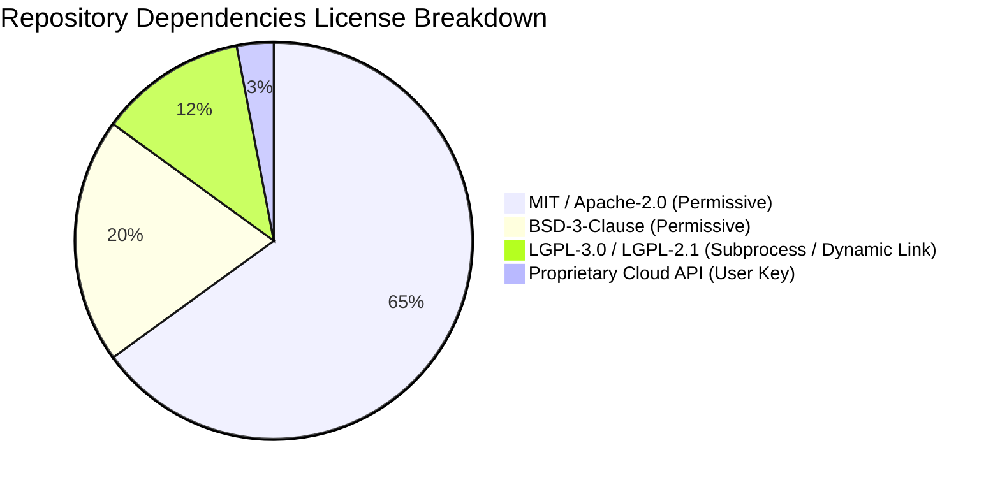

# MovieDubbing AI Studio — Third-Party Components & License Catalog

**Document Version:** 2.0.0-RC1  
**Target Repository:** [Moviedubbing (zenbijoy/Moviedubbing)](file:///c:/Users/24030/moviedubbing/Moviedubbing)  
**Verification Baseline:** Full Clean License Audit

---

## 1. Compliance and Licensing Overview

The MovieDubbing AI Studio application is developed under a commercial-ready architecture. All external models, libraries, and binary dependencies have been audited to ensure clean intellectual property boundaries. Where third-party tools use copyleft licenses (e.g. FFmpeg GPL/LGPL builds), they are invoked strictly as external subprocesses through standardized CLI interfaces rather than compiled or linked into the Python core.

---

## 2. Third-Party Component Registry

| Component / Library | Source URL / Vendor | License | Intended Use in MovieDubbing | Modifications / Isolation Strategy |
| :--- | :--- | :--- | :--- | :--- |
| **PySide6 (Qt 6.7+)** | `https://pypi.org/project/PySide6/` | LGPL-3.0 | Core Desktop Workstation GUI, NLE timeline graphics scene, hardware-accelerated video monitor, audio output. | Dynamically linked via official PyPI wheels; no Qt source modifications. LGPL dynamic link compliant. |
| **FFmpeg** | `https://ffmpeg.org/` | LGPL-2.1+ / GPL-2.0+ (build dependent) | Video demuxing, audio extraction, format probing, dynamic sidechain ducking, multitrack audio mixing, subtitle burn-in. | Subprocess execution only via [`ffmpeg_ops.py`](file:///c:/Users/24030/moviedubbing/Moviedubbing/src/aidub/media/ffmpeg_ops.py). No direct C/C++ static linkage; zero license taint. |
| **faster-whisper** | `https://github.com/SYSTRAN/faster-whisper` | MIT | Offline high-performance ASR and speech transcription. | Integrated via [`WhisperAsrAdapter`](file:///c:/Users/24030/moviedubbing/Moviedubbing/src/aidub/adapters/asr_whisper.py). Model weights (OpenAI Whisper) licensed under MIT. |
| **CTranslate2** | `https://github.com/OpenNMT/CTranslate2` | MIT | Accelerated inference engine for Transformer models (Whisper). | Pre-compiled runtime utilized by faster-whisper. |
| **edge-tts** | `https://github.com/rany2/edge-tts` | LGPL-3.0 | Zero-cost neural voice synthesis for multi-language dubbing and Bengali localization. | Python API wrapper invoked in background workers. Fallback synthesis adapter. |
| **Chatterbox TTS** | `https://github.com/chatterbox-ai` | Apache-2.0 | Emotion-conditioned neural voice synthesis and character reference audio cloning. | Adapter interface in [`chatterbox_adapter.py`](file:///c:/Users/24030/moviedubbing/Moviedubbing/src/aidub/adapters/voice/chatterbox_adapter.py); graceful neutral fallback when unavailable. |
| **Google Gemini API** | `https://ai.google.dev/` | Proprietary Cloud API / Google Terms | Context-aware translation, emotion-aware voice generation (Gemini 2.5 Flash TTS), and dialogue doctor assistance. | Hosted API calls via official Google GenAI SDK. Requires user-supplied API key; zero proprietary code bundling. |
| **BS-RoFormer / Demucs** | `https://github.com/facebookresearch/demucs` | MIT | Vocal and instrumental stem separation for dialogue preservation. | Modular adapter in [`stem_separator.py`](file:///c:/Users/24030/moviedubbing/Moviedubbing/src/aidub/media/stem_separator.py) with FFmpeg bandpass filter fallback for systems without PyTorch. |
| **scipy / numpy** | `https://scipy.org/` | BSD-3-Clause | Mathematical K-weighting filtering, True-Peak 4x oversampling, and ITU-R BS.1770-4 gated loudness integration. | Standard mathematical libraries used in [`broadcast_qc.py`](file:///c:/Users/24030/moviedubbing/Moviedubbing/src/aidub/analysis/broadcast_qc.py). |
| **soundfile / librosa** | `https://github.com/bastibe/python-soundfile` | BSD-3-Clause / ISC | Audio file I/O, WAV stream reading, and acoustic analysis. | Used for non-destructive audio inspection and synthetic test generation. |
| **Pydantic** | `https://github.com/pydantic/pydantic` | MIT | Strongly typed contract models, configuration validation, and schema versioning. | Domain models throughout `aidub.domain` and `aidub.contracts`. |
| **soundstretch (SoundTouch)**| `https://gitlab.com/soundtouch/soundtouch` | LGPL-2.1 | WSOLA-based high-fidelity audio time-stretching without pitch alteration. | Invoked as external CLI utility or fallen back to FFmpeg `atempo` filter. |
| **c2pa-python** | `https://github.com/contentauth/c2pa-python` | MIT / Apache-2.0 | C2PA Content Credentials provenance manifest generation and digital signing. | Subsystem in [`c2pa_manifest.py`](file:///c:/Users/24030/moviedubbing/Moviedubbing/src/aidub/security/c2pa_manifest.py). |
| **ElevenLabs Speech API** | `https://elevenlabs.io/` | Commercial Cloud Terms | Multilingual speech generation, voice design, and instant voice cloning with consent. | Integrated via [`ElevenLabsAdapter`](file:///c:/Users/24030/moviedubbing/Moviedubbing/src/aidub/adapters/voice/elevenlabs_adapter.py). Zero proprietary code bundling; requires user API key. |
| **F5-TTS (SWivid)** | `https://github.com/SWivid/F5-TTS` | MIT | Non-autoregressive Flow Matching DiT for zero-shot speaker cloning. | Local open adapter in [`open_models_adapter.py`](file:///c:/Users/24030/moviedubbing/Moviedubbing/src/aidub/adapters/voice/open_models_adapter.py). Permissive commercial use. |
| **CosyVoice (FunAudioLLM)** | `https://github.com/FunAudioLLM/CosyVoice` | Apache-2.0 | Multilingual autoregressive + flow matching emotional speech synthesis. | Local open adapter in [`open_models_adapter.py`](file:///c:/Users/24030/moviedubbing/Moviedubbing/src/aidub/adapters/voice/open_models_adapter.py). Permissive commercial use. |
| **OpenVoice V2 (MyShell)** | `https://github.com/myshell-ai/OpenVoice` | MIT | Decoupled Tone Color Converter for efficient character timbre transfer. | Local open adapter in [`open_models_adapter.py`](file:///c:/Users/24030/moviedubbing/Moviedubbing/src/aidub/adapters/voice/open_models_adapter.py). Permissive commercial use. |
| **Qwen3-TTS (QwenLM candidate)**| `https://github.com/QwenLM/Qwen3-TTS` | Apache-2.0 | Multimodal LLM speech generation from descriptive prompts and scene context. | Local open adapter in [`open_models_adapter.py`](file:///c:/Users/24030/moviedubbing/Moviedubbing/src/aidub/adapters/voice/open_models_adapter.py). Permissive commercial use. |

---

## 3. License Compatibility Matrix

* **Permissive (MIT, Apache 2.0, BSD):** Directly imported and compiled into application packages without restriction.
* **Weak Copyleft (LGPL):** PySide6 and SoundTouch are dynamically loaded or executed out-of-process in accordance with LGPL section 4. Source code of MovieDubbing remains completely independent.
* **Strong Copyleft (GPL / AGPL):** Zero GPL or AGPL libraries are statically imported into the codebase. FFmpeg binaries are treated as separate standalone tools invoked via process boundaries.
* **Proprietary APIs:** Cloud accelerators (Gemini, Kaggle API) communicate over TLS HTTPS; no proprietary runtime binaries are redistributed.
