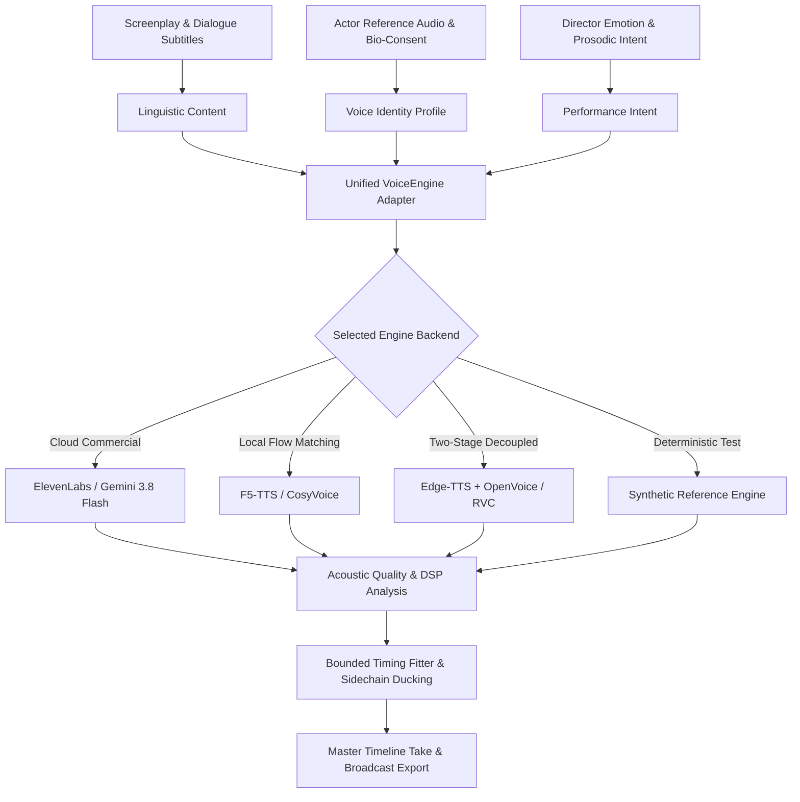

# Voice Engine Architecture & Unified Speech Generation Specification

## 1. Executive Summary

The MovieDubbing platform features a modular, enterprise-grade AI voice generation and cinematic dialogue localization engine inspired by the expressive quality, character consistency, and production controls of ElevenLabs.

The architecture enforces a strict **tripartite domain separation** where voice identity (timbre), performance intent (emotion/prosody), and linguistic content (phonetics/text) remain completely decoupled. This prevents voice leakage, eliminates hallucinated prosody, and guarantees that changing a character's emotional delivery does not corrupt their unique vocal timbre.

---

## 2. Core Architecture & Tripartite Domain Separation



### 2.1 The Three Orthogonal Vectors

1. **Voice Identity (`VoiceIdentity` / `CharacterVoiceProfile`)**:
   - Manages physical timbre, formant structure, and vocal tract acoustics.
   - Backed by authorized reference recordings or prompt-designed synthetic presets.
   - Strictly decoupled from language and emotional state.

2. **Performance Intent (`NormalizedPerformance` / `PerformanceIntent`)**:
   - Direction parameters: primary emotion (`neutral`, `angry`, `sad`, `fear`, `whisper`, `shout`, `joy`, `excited`, `calm`), emotion intensity ($0.0 \dots 1.0$), pace multiplier ($0.5\times \dots 2.0\times$), pitch shift ($-12 \dots +12$ semitones), and pause dynamics.
   - Normalized across all model backends: translated into model-specific control tags (e.g. ElevenLabs stability/style exaggeration, Gemini dramatic style prompt, or DiT guidance scale).

3. **Linguistic Content (`LinguisticContent` / `TranscriptCue`)**:
   - Phoneme representations, translated target text, target duration slots, and word-level alignment boundaries.

---

## 3. Unified Engine Interface Contract

Every voice synthesis adapter implements the runtime-checkable `VoiceEngine` protocol defined in [`src/aidub/adapters/voice_base.py`](file:///c:/Users/24030/moviedubbing/Moviedubbing/src/aidub/adapters/voice_base.py):

```python
@runtime_checkable
class VoiceEngine(Protocol):
    @property
    def engine_kind(self) -> VoiceEngineKind: ...

    @property
    def metadata(self) -> VoiceEngineMetadata: ...

    def is_available(self) -> tuple[bool, str]: ...

    def synthesize(self, request: SynthesisRequest, output_dir: str) -> SynthesisResult: ...

    def design_voice(self, prompt: VoiceDesignPrompt) -> dict[str, Any]: ...

    def verify_reference_audio(self, audio_path: str) -> ReferenceAudioAnalysis: ...
```

### 3.1 Metadata & Transparency Manifest (`VoiceEngineMetadata`)

Every adapter exposes its capabilities, hardware specifications, and licensing terms:

| Field | Type | Description |
|---|---|---|
| `engine_kind` | `VoiceEngineKind` | Unique string enum (`edge_tts`, `gemini_tts`, `elevenlabs`, `f5_tts`, etc.) |
| `display_name` | `str` | Human-readable studio name |
| `model_id` | `str` | Exact checkpoint / model identifier (e.g. `SWivid/F5-TTS`, `eleven_multilingual_v2`) |
| `capabilities` | `set[EngineCapability]` | Real supported capabilities (no fabricated features) |
| `hardware_requirements` | `str` | Minimum RAM, VRAM, and accelerator prerequisites |
| `license_info` | `str` | MIT, Apache 2.0, or Commercial Terms |
| `commercial_use_allowed`| `bool` | Whether commercial localization/film delivery is legally permitted |
| `min_ram_gb` / `min_vram_gb` | `float` | Hardware resource gates |
| `is_local` / `is_cloud_api` | `bool` | Execution boundary |
| `known_limitations` | `list[str]` | Operational caveats and trade-offs |

---

## 4. Hardware Management, Lazy Loading & Memory Controller

To prevent running multiple large neural models simultaneously (which causes GPU Out-of-Memory crashes on consumer workstations), [`VoiceEngineRegistry`](file:///c:/Users/24030/moviedubbing/Moviedubbing/src/aidub/adapters/voice/engine_registry.py) enforces:

1. **Lazy Instantiation**: Checkpoints and REST connections are created on-demand when requested by a job.
2. **Pre-flight Hardware Memory Verification**:
   - Queries system host RAM via `psutil` or `ctypes.GlobalMemoryStatusEx`.
   - Queries CUDA device name, total VRAM, and allocated VRAM via `torch.cuda`.
   - Emits immediate warnings if a requested local model requires more VRAM than is currently free.
3. **Explicit Memory Deallocation**:
   - `unload_engine(kind)` and `unload_all_engines()` delete active references, invoke Python garbage collection (`gc.collect()`), and flush CUDA memory caches (`torch.cuda.empty_cache()`).
4. **Intelligent Fallback Resolution**:
   - If an engine is unconfigured (e.g. missing API key) or its local checkpoint is absent, `resolve_effective_engine()` automatically routes synthesis to the best ready engine (e.g. Edge-TTS or Synthetic) and records explicit fallback warnings.

---

## 5. Bounded Timing Adaptation & Sidechain Mixing Integration

Voice synthesis takes are integrated into the movie dubbing timeline through a 5-step bounded timing pipeline:

1. **Duration Budgeting**: Target slot duration is extracted from source dialogue cues ($T_{\text{slot}}$).
2. **Actual Measurement**: Raw synthesized audio is measured on disk via `aidub.media.ffmpeg_ops.duration`.
3. **Bounded Time-Stretching**:
   - If $\Delta \le \pm 8\%$, high-quality time-stretch (`soxr` / `rubberband`) fits speech into the exact video slot without audible pitch distortion.
4. **Pacing Adjustment**: If $\Delta > \pm 8\%$, the engine can re-synthesize using supported speaking-rate parameters ($0.85\times \dots 1.20\times$).
5. **Human Review Flagging**: If duration discrepancy exceeds $\pm 15\%$ after bounded adjustment, the take is flagged for editor review in the Inspector rather than forcing robotic, extreme compression.
6. **Sidechain Ducking**: During final mixdown, background music and ambient Foley stems are dynamically ducked by $-12 \text{ dB}$ (with $15\text{ms}$ attack and $250\text{ms}$ release) whenever actor dialogue is active.
