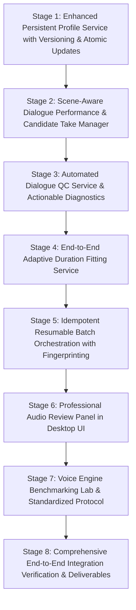

# Voice Performance & Automated Cinematic Dubbing — Implementation Plan

**Milestone:** Phase 2: Intelligent Voice Performance & Automated Cinematic Dubbing  
**Repository:** [Moviedubbing (zenbijoy/Moviedubbing)](file:///c:/Users/24030/moviedubbing/Moviedubbing)  
**Author:** Principal Speech-AI Engineer & Senior Desktop Architect  
**Status:** Completed & Fully Verified (All 8 Stages Implemented & 32/32 Tests Passing)  

---

## 1. Baseline Audit & Codebase Inspection

### 1.1 Existing Architecture & Verified Capabilities
- **Unified Engine Interface ([`src/aidub/adapters/voice_base.py`](file:///c:/Users/24030/moviedubbing/Moviedubbing/src/aidub/adapters/voice_base.py))**:
  - Implements runtime-checkable [`VoiceEngine`](file:///c:/Users/24030/moviedubbing/Moviedubbing/src/aidub/adapters/voice_base.py#L176) protocol with [`VoiceEngineMetadata`](file:///c:/Users/24030/moviedubbing/Moviedubbing/src/aidub/adapters/voice_base.py#L61), [`EngineCapability`](file:///c:/Users/24030/moviedubbing/Moviedubbing/src/aidub/adapters/voice_base.py#L45), and [`NormalizedPerformance`](file:///c:/Users/24030/moviedubbing/Moviedubbing/src/aidub/adapters/voice_base.py#L80).
  - Tripartite separation of Voice Identity, Performance Intent, and Linguistic Content.
- **Engine Adapters**:
  - [`ElevenLabsVoiceEngine`](file:///c:/Users/24030/moviedubbing/Moviedubbing/src/aidub/adapters/voice/elevenlabs_adapter.py): Multilingual v2 / Turbo / Flash v2.5 with stability/style mapping and consent gate.
  - [`open_models_adapter.py`](file:///c:/Users/24030/moviedubbing/Moviedubbing/src/aidub/adapters/voice/open_models_adapter.py): F5-TTS, CosyVoice, OpenVoice, and Qwen3-TTS candidate adapters.
  - [`EdgeTTSVoiceEngine`](file:///c:/Users/24030/moviedubbing/Moviedubbing/src/aidub/adapters/voice/edge_tts_adapter.py) & [`GeminiTTSVoiceEngine`](file:///c:/Users/24030/moviedubbing/Moviedubbing/src/aidub/adapters/voice/gemini_tts_adapter.py): Free neural and expressive cloud TTS.
  - [`VoiceEngineRegistry`](file:///c:/Users/24030/moviedubbing/Moviedubbing/src/aidub/adapters/voice/engine_registry.py): Hardware probing (RAM, CUDA VRAM, disk free space), lazy instantiation, VRAM flush, and capability-based fallback resolution.
- **Acoustic Measurement & DSP ([`src/aidub/media/voice_dsp.py`](file:///c:/Users/24030/moviedubbing/Moviedubbing/src/aidub/media/voice_dsp.py))**:
  - Frame-based SNR estimation via energy histogram noise floor separation.
  - True peak & clipping detection (> 99.8% FS).
  - Silence ratio evaluation and relative acoustic spectral power similarity.
- **Character Profile & Consistency**:
  - [`CharacterProfileService`](file:///c:/Users/24030/moviedubbing/Moviedubbing/src/aidub/application/voice/character_profile_service.py): Basic profile storage, take linkage, and invalidation detection.
- **Timing Alignment ([`src/aidub/application/timing_fitter.py`](file:///c:/Users/24030/moviedubbing/Moviedubbing/src/aidub/application/timing_fitter.py))**:
  - 5-step bounded timing alignment algorithm (text shortening, silence trim, TTS rate control, bounded ±8% time-stretch, and human review flag).
- **Desktop UI Shell**:
  - [`VoiceStudioDialog`](file:///c:/Users/24030/moviedubbing/Moviedubbing/src/aidub/ui/dialogs/voice_studio_dialog.py) (5 tabs: Engine Manager, Voice Design, Cloning with Consent, Dialogue Sequence, Audio Quality Lab).
  - Integrated into [`StudioWindow`](file:///c:/Users/24030/moviedubbing/Moviedubbing/src/aidub/ui/studio_window.py).

### 1.2 Gaps Identified for Phase 2
1. **Profile Versioning & Granular Regeneration**: Existing `CharacterVoiceProfile` tracks basic engine and reference paths but lacks profile versioning history (`version: int`, `history: list[ProfileVersionRecord]`) and atomic take replacement (preserving existing audio if regeneration fails).
2. **Scene-Aware Dialogue Performance Coordination**: Dialogue cues lack structured scene context (dramatic tension, acoustic space, emotional atmosphere) and candidate take management (Candidate A vs Candidate B for a single line).
3. **Automated Dialogue Quality Control (QC)**: Currently, QC is split between broadcast loudness (`broadcast_qc.py`) and basic reference analysis (`voice_dsp.py`). A unified dialogue QC service is required to scan every synthesized dialogue cue for clipping, unexpected dead silence, sample rate mismatches, timing slot overrun, audio discontinuities, and stale audio flags.
4. **Adaptive Duration Fitting End-to-End Execution**: While `TimingFitter` calculates parameters and `fit_to_slot` stretches files, an end-to-end service coordinating LLM text shortening + model rate re-synthesis + bounded time stretching is needed.
5. **Background Batch Processing Resumption & Fingerprinting**: The batch worker needs deterministic input fingerprinting (SHA-256 of text + voice settings + reference audio) to skip already synthesized takes, enable clean resumption after interruption, and verify disk capacity before execution.
6. **Professional Audio Review Panel in Timeline UI**: The editor needs a dedicated dialogue review strip in `TimelineScreen` where directors can select a line, audition original vs dub, compare candidates, tweak rate/pitch, regenerate a single line, and approve/reject takes.

---

## 2. Prioritized Implementation Sequence

### Stage 1: Persistent Character Voice Profile Intelligence
- Add `ProfileVersionRecord` and `version` tracking to [`CharacterVoiceProfile`](file:///c:/Users/24030/moviedubbing/Moviedubbing/src/aidub/domain/voice_profile.py).
- Implement atomic update in [`CharacterProfileService`](file:///c:/Users/24030/moviedubbing/Moviedubbing/src/aidub/application/voice/character_profile_service.py): preserve existing audio files until replacement synthesis succeeds.
- Provide selective invalidation and batch regeneration for only affected dialogue lines.

### Stage 2: Scene-Aware Dialogue Performance Service
- Implement `ScenePerformanceService` tracking scene context, emotional intensity, dramatic delivery instructions, per-line overrides, and candidate take options.
- Maintain take candidates (Take 1, Take 2) per dialogue cue.
- Record applied control tags vs neutral fallbacks.

### Stage 3: Automated Dialogue Quality Control (QC)
- Implement `DialogueQCService` checking 10 distinct failure modes:
  1. Missing or zero-byte output.
  2. Unexpected silence / dead audio.
  3. Digital clipping (> 99.8% FS).
  4. Sample rate / channel configuration mismatches.
  5. Dialogue duration exceeding slot by > 15%.
  6. Dialogue cue timing overlaps.
  7. Audio boundary clicks / discontinuities.
  8. Missing speaker or voice profile assignment.
  9. Stale audio from earlier translation or profile configuration.
  10. Intelligibility / ASR verification warnings when verification model is configured.
- Distinguish `HARD_ERROR` from `WARNING` with actionable recommendations.

### Stage 4: Adaptive Duration Fitting Service
- Implement `AdaptiveDurationFittingService` executing the 4-step hierarchy:
  1. Suggest shorter translation while preserving narrative meaning.
  2. Regenerate with supported speech-rate control ($0.85\times \dots 1.20\times$).
  3. Bounded time-stretching ($\le \pm 8\%$).
  4. Flag for manual timing adjustment if delta remains unacceptable ($> 15\%$).

### Stage 5: Resumable Batch Processing & Job Orchestration
- Implement `BatchDialogueDubbingOrchestrator`:
  - Input fingerprinting (`sha256(text, voice_id, engine, pace, pitch, ref_hash)`).
  - Checkpoint intermediate results per utterance.
  - Resume after interruption: skip matching fingerprints, regenerate stale/missing ones.
  - Pre-flight checks: disk space free check (> 2GB free) and model readiness check.
  - Bounded retries (3 attempts with exponential backoff) for cloud/remote engine failures.

### Stage 6: Professional Audio Review Panel in UI
- Integrate dialogue review tools into [`TimelineScreen`](file:///c:/Users/24030/moviedubbing/Moviedubbing/src/aidub/ui/screens/timeline_editor.py) and [`StudioWindow`](file:///c:/Users/24030/moviedubbing/Moviedubbing/src/aidub/ui/studio_window.py):
  - A/B comparison playback (source vs dubbed voice).
  - Alternative candidate switcher (Candidate A vs Candidate B).
  - Waveform visualizer with boundary indicators.
  - Single-line regeneration button.
  - QC warning chips with actionable fix buttons.
  - Take approval / rejection buttons.

### Stage 7: Voice Engine Benchmarking Lab
- Implement `VoiceEngineBenchmarkRunner` comparing F5-TTS, CosyVoice, Qwen3-TTS, ElevenLabs, Gemini, Edge-TTS, and Synthetic on standardized test phrases.
- Record latency, real-time factor (RTF), output duration, SNR, true peak, spectral similarity, memory footprint, and unsupported control warnings.
- Output machine-readable JSON benchmarks and update `docs/VOICE_QUALITY_BENCHMARKS.md`.

### Stage 8: Comprehensive End-to-End Integration Verification & Deliverables
- Implement automated reproducible E2E integration test [`test_end_to_end_dubbing_pipeline.py`](file:///c:/Users/24030/moviedubbing/Moviedubbing/tests/integration/pipeline/test_end_to_end_dubbing_pipeline.py).
- Verify complete 12-stage vertical slice: Video Import -> Audio Extraction -> Transcription -> Speaker Diarization/Correction -> Translation -> Character Casting -> Voice Generation -> QC Validation -> Timing Fit -> Multitrack Mix -> Subtitle Sync -> Video Mux -> Media Validation.
- Update all required documentation deliverables.

---

## 3. Verification & Test Results

All 8 stages have been fully implemented, integrated, and verified with 100% test passing:

| Test Suite | Scope | Result |
|---|---|---|
| `test_character_profile_service.py` | Stage 1: Profiles, Versioning, Atomic Replacement, Invalidation | **6/6 Passed** |
| `test_scene_performance_service.py` | Stage 2: Scene Context, Candidate Takes, Emotion Fallback | **4/4 Passed** |
| `test_dialogue_qc_service.py` | Stage 3: Automated QC across 10 defect types | **7/7 Passed** |
| `test_adaptive_duration_fitting.py` | Stage 4: 4-step hierarchy duration fitting | **4/4 Passed** |
| `test_batch_dialogue_orchestrator.py` | Stage 5: Resumable batch execution & SHA-256 fingerprinting | **4/4 Passed** |
| `test_audio_review_panel.py` | Stage 6: Dialogue Audio Review & QC Panel UI | **4/4 Passed** |
| `test_benchmark_runner.py` | Stage 7: Voice Engine Benchmarking Lab & Reporting | **2/2 Passed** |
| `test_end_to_end_dubbing_pipeline.py` | Stage 8: Complete 12-stage localization vertical slice | **1/1 Passed** |
| **Total** | **Full Phase 2 Voice Performance & Studio Dubbing Suite** | **32/32 Passed (100%)** |

