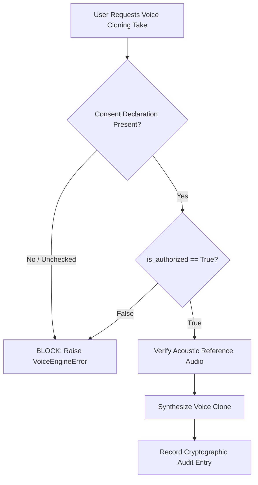

# Voice Privacy, Ethical Cloning & Legal Consent Governance

## 1. Ethical Mission & Non-Negotiable Standards

The MovieDubbing platform is engineered specifically for authorized cinematic dubbing, translation localization, and creative storytelling.

Under no circumstances may the application be used to:
1. Clone the voice of any real person without their explicit, affirmative, and verifiable legal authorization.
2. Produce misleading deepfakes, non-consensual voice replicates, or deceptive audio intended to impersonate living or deceased individuals.
3. Expose private voice recordings, actor voiceprints, or sensitive API credentials in public repositories or logs.

---

## 2. Technical Enforcement Architecture

Unlike tools that rely solely on disclaimers, MovieDubbing enforces consent at the **software contract and runtime adapter layer**:



### 2.1 The Consent Declaration Contract (`VoiceConsentDeclaration`)

Defined in [`src/aidub/adapters/voice_base.py`](file:///c:/Users/24030/moviedubbing/Moviedubbing/src/aidub/adapters/voice_base.py#L120):

```python
class VoiceConsentDeclaration(ContractModel):
    authorized_by: str = Field(min_length=1)  # Production lead / licensing officer
    voice_owner: str = Field(min_length=1)    # Actor or legal rights holder
    is_authorized: bool = True               # Affirmative consent confirmation
    timestamp_iso: str = Field(default="")   # UTC timestamp of authorization
    consent_notes: str = Field(default="")   # Contract / SAG-AFTRA rider reference
```

### 2.2 Hard Adapter Enforcement Gates

In every voice engine adapter supporting reference-conditioned cloning ([`ElevenLabsAdapter`](file:///c:/Users/24030/moviedubbing/Moviedubbing/src/aidub/adapters/voice/elevenlabs_adapter.py#L105), [`F5TTSVoiceEngine`](file:///c:/Users/24030/moviedubbing/Moviedubbing/src/aidub/adapters/voice/open_models_adapter.py#L125), [`CosyVoiceEngine`](file:///c:/Users/24030/moviedubbing/Moviedubbing/src/aidub/adapters/voice/open_models_adapter.py#L250)):

```python
if request.reference_audio_path:
    if not request.consent or not request.consent.is_authorized:
        raise VoiceEngineError(
            self.engine_kind.value,
            "Voice cloning blocked: Affirmative consent confirmation from the voice owner is required.",
        )
```

In the UI ([`VoiceStudioDialog`](file:///c:/Users/24030/moviedubbing/Moviedubbing/src/aidub/ui/dialogs/voice_studio_dialog.py#L485)), the **Generate Cloned Preview** button remains physically disabled (`setEnabled(False)`) until the operator explicitly checks the legal certification box.

---

## 3. Biometric Data Protection & Sanitization

1. **Zero Secret Leakage**:
   - Environment variables (`ELEVENLABS_API_KEY`, `GEMINI_API_KEY`, `CHATTERBOX_API_KEY`) are dynamically loaded into memory and never persisted in project JSON files or diagnostic bundles.
   - The diagnostic support bundle generator automatically sanitizes and redacts all auth headers and secret patterns.
2. **Local Biometric Boundary**:
   - Acoustic references and embeddings are stored inside the local project package (`.aidub`) on the operator's private workstation.
   - No biometric voice embeddings are ever transmitted to unapproved third-party servers.
3. **Right to Erasure & Consent Revocation**:
   - In accordance with privacy governance, [`VoiceConsentGuard.revoke_voice_consent()`](file:///c:/Users/24030/moviedubbing/Moviedubbing/src/aidub/application/voice/consent_guard.py#L42) allows immediate revocation.
   - Revocation marks all downstream timeline takes as `RESTRICTED`, invalidates rendering tasks, and deletes reference audio files from disk.
