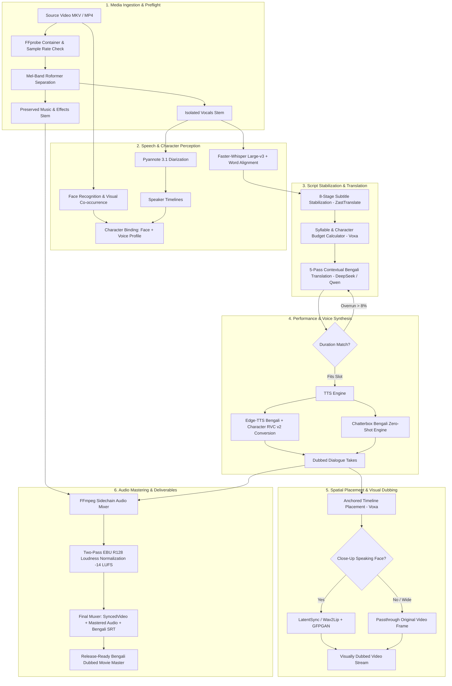

# Recommended End-to-End Bengali Movie Dubbing Architecture

Synthesized blueprint incorporating the strongest architectural patterns discovered across the 41 audited repositories.

---

## MVP vs. Full Build Roadmap

### Phase 1: MVP Pipeline (2 Weeks)
* Mel-Band Roformer separation
* Faster-Whisper ASR + WhisperX alignment
* Voxa-style anchored placement
* Gemini/Qwen length-budgeted Bengali translation
* Edge-TTS Bengali (`bn-BD-NabanitaNeural` / `bn-BD-PradeepNeural`)
* FFmpeg M&E stem mix with loudness normalization

### Phase 2: Character Identity & Zero-Shot Cloning (3 Weeks)
* Face + Voice co-occurrence character binding (Dub Studio pattern)
* RVC v2 voice conversion model per character
* 8-stage subtitle stabilization (ZastTranslate pattern)
* Automated back-transcription quality control gate

### Phase 3: Visual Lip-Sync & Desktop Workstation (4 Weeks)
* Selective shot-based LatentSync visual dubbing
* PySide6 / Qt6 editorial timeline with draggable utterance waveforms
* Embedded MCP server for autonomous AI assistant control
